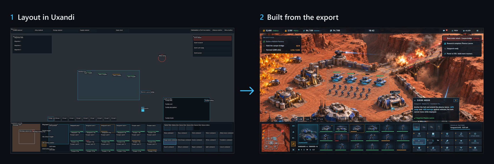

# Uxandi

UI layout canvas for agentic workflows. Each shape becomes a UI element, defined by your notes.

Design tooling turns the layout into rules. Prompt-based context, programmatic placement.

Any project, framework or language. The agent only needs the JSON.

- Desktop app, Python + PySide6
- Containers only: rectangles, circles / ovals, lines
- Freehand drawing: any stroke is a shape with notes (marks, corrections, arrows)
- Real device canvases: desktop, iPad, phone
- Notes on every shape, page and project carry the meaning
- No text element, no role presets
- Export: pixel boxes, styles, nesting, notes
- Export adds nothing beyond what you wrote
- 29 agent tools over MCP and command line

## How Uxandi differs

### Scope
- Layout plus written intent: position, size, nesting, purpose, look
- The look is described in words: notes and the project brief
- Optional visual hints: fill, border, corners, pictures
- No visual design step. The agent builds what the user wrote
- No component library. Every element is a container, and its meaning is in its notes
- No text element, no role presets

### Input
- Rectangles, circles / ovals, lines and freehand strokes on fixed device canvases
- Notes on every shape and page: content, behaviour, states, style
- Project brief: product, audience, visual style, rules
- Dot grid from 1 px

### Output
- One JSON file of data only: pixel boxes, nesting, styles, notes
- Nothing added beyond what the user wrote
- Format published as a JSON Schema (2020-12), with a validator included
- Compact form: same facts, about 5x smaller
- Re-importable

### AI
- No built-in model, no generation limits, no API key
- Works with any MCP agent
- The same agent can lay out and then build
- 29 tools covering layout, copies, templates, checks, screenshots, export, import
- Live mode: the agent edits the open app, each command one undo step
- File mode: the agent edits project files with the app closed

### Running it
- Local, offline after install
- No account, no cloud, no telemetry
- Free, open source
- Agent server: Python standard library only

## Examples

Left: layout in Uxandi. Right: UI an agent built from the export.


<p align="center"><sub><b>Phone app</b> · iPhone 16 Pro · 3 screens</sub></p>


<p align="center"><sub><b>Streaming site</b> · desktop web, 1440 × 2400 · poster and hero art: Codex</sub></p>



<p align="center"><sub><b>Strategy game HUD</b> · 1920 × 1080 · 123 boxes · game art: Codex</sub></p>

## Requirements

| Need | Version | Notes |
|---|---|---|
| Python | 3.9+ | Tested on 3.14. Windows: tick "Add python.exe to PATH" |
| PySide6 | 6.8+, below 7 | Only dependency. `requirements.txt` |
| OS | Windows 10 / 11, macOS, Linux | Tested on Windows only |

- No database, server, account or internet after install
- Agent tools: Python standard library only
- Linux, error `Could not load the Qt platform plugin "xcb"`:

  ```
  sudo apt install libxcb-cursor0 libxkbcommon-x11-0
  ```

## Install and run

```
git clone https://github.com/UxandiCreative/UxandIDesign.git
cd UxandIDesign
python -m venv .venv
.venv\Scripts\activate             # Windows
source .venv/bin/activate          # macOS / Linux
python -m pip install -r requirements.txt
python main.py
```

- No git: Code > Download ZIP
- `python` not found: `python3`
- venv optional. Activate before each run
- Opens maximized. F11: full screen

## AI agents (MCP)

| App | Mode | Agent |
|---|---|---|
| Open | live | Works in the window. Each command one Ctrl+Z step |
| Closed | file | Edits project files, saves each change |

```
python uxandi_agent.py mcp                MCP server
python uxandi_agent.py call get_status    one tool, command line
```

- Setup files: `.mcp.json` (Claude Code), `.vscode/mcp.json` (VS Code), `.cursor/mcp.json` (Cursor). Approve server `uxandi`
- Other clients, command line: [AGENTS.md](AGENTS.md)
- Tools, recipes: [TOOLS.md](TOOLS.md)
- MCP resources: export schema, tool reference. Prompts: design screen, design flow, review, hand-off

## Window

| Area | Holds |
|---|---|
| Header | Project name, Open / New / Save / Save as, tools (Select V, Rectangle R, Circle C, Line L, Draw D), undo / redo, zoom, Export JSON (▾: copy only, open folder, import) |
| Left tabs | Brief (project brief, page notes), Canvas (size, presets, My screen = this monitor, dot spacing 1–400 px, margins), Create, Snapping, View |
| Right tabs | Shape (name, position, size), Design (fill, border, corners, images, templates), Transform (rotate, flip, order), Details (all facts on the selection), Shapes (list, drag to reorder) |
| Canvas | Group pills bottom-left. Page strip bottom: click opens, drag reorders, `+` adds, right-click renames / copies / removes |

## Mouse and keys

| Input | Action |
|---|---|
| Drag shape | Move. Snaps to edges, centres, canvas, equal gaps |
| Handles | Square: resize. Round: rotate. Pink corner: radius |
| Right / middle / Space drag | Pan |
| Wheel | Zoom to cursor |
| Shift | Keep proportions, lock axis, 15° turns, 45° lines |
| Alt | Resize from centre. Alt-drag copies |
| Ctrl while dragging | No snapping |
| Arrows / Shift+arrows | Nudge 1 / 10 px. Dot snapping: 1 / 5 dots |
| Number box arrows, wheel, ↑ / ↓ | Step the value. Hold to repeat |
| Slider ‹ › | Step 1%. Hold to repeat |
| Double-click, F2 | Name shape |
| Ctrl+D, Ctrl+C / V / X, Del | Duplicate, copy / paste / cut, delete |
| Ctrl+G / Ctrl+Shift+G | Group / remove from group |
| Ctrl+] / [ (Shift: front / back) | Layer order |
| Shift+H / Shift+V | Flip |
| Ctrl+Z / Ctrl+Y | Undo / redo |
| Ctrl+0 / Ctrl+1 | Fit / 100% |
| Ctrl+PgUp / PgDn | Previous / next page |

## Export

| Kind | Menu | For | Content |
|---|---|---|---|
| Compact (default) | Export JSON | LLM builder | Reading guide, brief, pages (size, device, margins, dot grid, notes, groups), elements (name, notes, type, box, rotation, parent, group, colours + opacity, border, radius, image fit / zoom / offset / opacity). Empty, default, derivable values left out. About 5x smaller. `how_to_read` lists every default |
| Full | ▾ > Export full JSON | Code that parses it | Same facts, every field written out, plus centre, canvas %, layer, children, nesting tree |

```
exports/<project>/
  <project>.compact.ui.json           newest compact export
  <project>.ui.json                   newest full export
  history/<project>_<date_time>.json  every export
  images/                             pictures used in shapes
```

- Export holds data only. Instructions come from your notes
- Copied to clipboard on export
- Import: ▾ > Import an export
- Format: JSON Schema, [schema/ui.compact.schema.json](schema/ui.compact.schema.json), [schema/ui.schema.json](schema/ui.schema.json)
- Each export names its schema in `$schema`
- Validate: `python uxandi_agent.py validate <file>`
- [schema/](schema/) also covers project files, Design templates, agent tools (`tools.json`)

## Files

Created on first use. Git-ignored.

| Path | Holds |
|---|---|
| `projects/*.uxandi` | Projects |
| `exports/` | Exports |
| `assets/images/` | Pictures in shapes |
| `templates/design/` | Design templates |
| `data/session.json` | Last session, reopened on launch |
| `data/bridge.json` | App open only: port + token for agents |

`UXANDI_HOME=<folder>`: moves `projects/`, `exports/`, `templates/`, `data/`.

## Tests

| Script | Covers |
|---|---|
| `tools/check_app.py` | App, headless. Screenshots to `tools/_check/` |
| `tools/check_agent.py` | Agent tools in file mode, live app, MCP. Schema and `TOOLS.md` sync, export validation, every `TOOLS.md` recipe |
